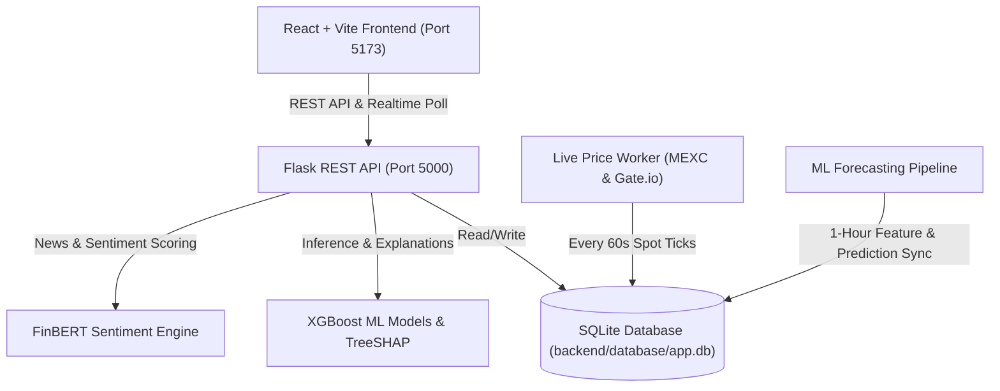

# Cryptocurrency Prediction and Market Analysis System

An explainable, production-ready full-stack machine learning decision-support platform that integrates real-time market data across 1,000+ cryptocurrency assets, XGBoost price forecasting with bounded prediction corridors, FinBERT financial-news sentiment analysis, and TreeSHAP feature-level model explainability.

---

## 🏗️ Architecture Overview



---

## 📁 Project Directory Structure

```text
Cryptocurrency_Prediction_and_Market_Analysis/
├── .env.example                     # Environment configuration template
├── .gitignore                       # Git ignore rules for caches, builds, & DB journals
├── requirements.txt                 # Backend Python package dependencies
├── README.md                        # Master project documentation
│
├── backend/
│   ├── app.py                       # Flask application factory & blueprint registry
│   ├── config.py                    # App configuration & database path binding
│   ├── scheduler.py                 # Background task scheduling setup
│   ├── api/                         # REST API route handlers
│   │   ├── health_routes.py         # System health check & DB verification
│   │   ├── market_routes.py         # Top cryptocurrencies, spot prices, & chart data
│   │   ├── news_routes.py           # Financial news articles
│   │   ├── prediction_routes.py     # ML price predictions & bounded corridors
│   │   ├── sentiment_routes.py      # Sentiment aggregation & distribution
│   │   └── watchlist_routes.py      # User watchlist management
│   ├── database/
│   │   ├── app.db                   # Primary SQLite database (1,000+ cryptos, 450k+ market ticks)
│   │   └── schema.sql               # Relational database schema definitions
│   ├── data/
│   │   └── update_pipeline.py       # Ingestion & feature update worker
│   ├── ml/
│   │   ├── artifacts/models/        # Pre-trained XGBoost model artifacts (.joblib)
│   │   ├── config/hyperparameters.yaml # ML training hyperparameters
│   │   ├── explainability/shap_explainer.py # TreeSHAP feature contribution calculation
│   │   ├── features/build_features.py       # 23 engineered technical & momentum features
│   │   ├── inference/predict.py             # Inference engine & adaptive corridor calculation
│   │   ├── sentiment/finbert.py             # FinBERT NLP sentiment scoring
│   │   └── training/train_xgboost.py        # Model retraining pipeline
│   ├── models/
│   │   └── db_models.py             # SQLAlchemy ORM models
│   ├── services/
│   │   ├── market_data_service.py   # Multi-exchange market data feed (CoinGecko, MEXC, Gate.io)
│   │   └── news_service.py          # News aggregation service
│   ├── tests/
│   │   ├── conftest.py              # Pytest fixtures and test client configuration
│   │   └── test_api.py              # API endpoint unit & integration tests
│   └── utils/
│       └── error_handlers.py        # Standardized JSON error response handlers
│
├── frontend/
│   ├── index.html                   # Single-page application entry HTML
│   ├── package.json                 # Node.js dependencies & scripts
│   ├── vite.config.js               # Vite build and proxy configuration
│   ├── public/
│   │   └── favicon.svg              # Platform icon
│   └── src/
│       ├── main.jsx                 # React root render
│       ├── App.jsx                  # Main routing & application layout
│       ├── index.css                # Enterprise dark design system & Tailwind styles
│       ├── api/client.js            # Axios HTTP client configured for backend proxy
│       ├── context/CurrencyContext.jsx # Global INR (₹) / USD ($) currency switcher
│       ├── pages/
│       │   ├── Dashboard.jsx        # Primary analysis dashboard with ML forecast & TreeSHAP
│       │   ├── Markets.jsx          # Live market table with search, sorting, & pagination
│       │   └── News.jsx             # Live financial news with FinBERT sentiment tags
│       ├── components/
│       │   ├── CoinSelector.jsx     # Asset search and selector
│       │   ├── PredictionCard.jsx   # 24h prediction, confidence badge, & corridor bounds
│       │   ├── PriceChart.jsx       # Interactive price chart with forecast corridor overlays
│       │   ├── PriceHistoryStats.jsx# Historical trading statistics & 24h ranges
│       │   ├── SentimentCard.jsx    # FinBERT sentiment gauge & article breakdown
│       │   ├── ShapExplainability.jsx # Top positive & negative feature impact visualization
│       │   ├── Sidebar.jsx          # Collapsible navigation drawer
│       │   └── TopTicker.jsx        # Real-time marquee ticker for top market assets
│       └── utils/
│           ├── coinLogos.js         # Cryptocurrency logo resolvers & dynamic fallbacks
│           └── currencyConfig.js    # Currency formatting utilities & live exchange rates
│
└── scripts/
    ├── run_all.py                   # Master unified startup script (Backend + Frontend + Engines)
    ├── fetch_live.py                # High-throughput spot ticker poller for 1,000 assets
    ├── audit_system.py              # Complete database, ML model, & inference health auditor
    ├── batch_predict_1000.py        # Comprehensive batch prediction runner across all coins
    ├── fetch_data.py                # Initial historical market data fetcher & DB initializer
    ├── seed_data.py                 # Core cryptocurrency baseline seeder
    ├── sync_live_and_predict.py     # Real-time price sync & daily prediction runner
    └── update_corridors.py          # Prediction corridor utility
```

---

## 🚀 Quick Start

### 1. Prerequisites
- **Python**: 3.10+ (Recommended: virtual environment in `venv/`)
- **Node.js**: 18+ and `npm`

### 2. Environment Setup
Create a `.env` file in the project root (or copy from `.env.example`):
```bash
cp .env.example .env
```

### 3. Launch the Entire System (One Command)
Run the master orchestration script:
```bash
python scripts/run_all.py
```
This automatically initiates:
1. **Backend Flask API** on `http://127.0.0.1:5000`
2. **Frontend React App** on `http://localhost:5173`
3. **Live Price Engine** polling MEXC & Gate.io spot tickers every 60 seconds
4. **ML Inference Engine** keeping 24-hour predictions and SHAP explanations updated

---

## 🧪 Testing & Verification

### Run Automated Unit & Pipeline Tests
```bash
.\venv\Scripts\python -m pytest backend/tests backend/ml/tests
```

### Run Comprehensive System Audit
```bash
.\venv\Scripts\python scripts/audit_system.py
```

### Build Frontend for Production
```bash
cd frontend
npm run build
```
